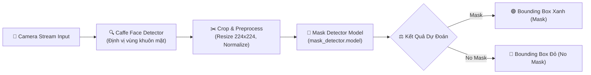

<div align="center">

# 😷 REAL-TIME FACE MASK DETECTOR 😷
### 🔬 Deep Learning & Computer Vision-Based COVID-19 Safety Monitoring
*Hệ Thống Nhận Diện Người Đeo Khẩu Trang Thời Gian Thực Phòng Chống Dịch COVID-19*

[](https://python.org)
[](https://tensorflow.org/)
[](https://opencv.org/)
[](https://keras.io/)

---

</div>

> [!IMPORTANT]
> **Real-Time Face Mask Detector** áp dụng mạng nơ-ron tích chập (MobileNetV2 / CNN) và OpenCV để phát hiện chính xác những người đeo hoặc không đeo khẩu trang từ luồng camera trực tiếp, hỗ trợ công tác kiểm soát an toàn dịch tễ tại các nơi công cộng.

---

## 📑 Mục Lục (Table of Contents)
- [✨ Tính Năng Nổi Bật](#-tính-năng-nổi-bật)
- [🏗️ Luồng Hoạt Động (Pipeline)](#️-luồng-hoạt-động-pipeline)
- [📂 Cấu Trúc Dự Án](#-cấu-trúc-dự-án)
- [⚙️ Công Nghệ Sử Dụng](#️-công-nghệ-sử-dụng)
- [🚀 Hướng Dẫn Cài Đặt & Sử Dụng](#-hướng-dẫn-cài-đặt--sử-dụng)
- [📜 Giấy Phép (License)](#-giấy-phép-license)

---

## ✨ Tính Năng Nổi Bật

| Biểu Tượng | Tính Năng | Mô Tả Chi Tiết |
| :---: | :--- | :--- |
| 📹 | **Nhận Diện Khung Hình Thời Gian Thực** | Quét liên tục luồng camera webcam (`detect_mask_video.py`) với độ trễ cực thấp. |
| 🟢 | **Phân Loại Đa Trạng Thái** | Đóng khung màu Xanh lá cho người đeo khẩu trang đúng quy chuẩn và màu Đỏ cho người không đeo. |
| 🧠 | **Mô Hình Huấn Luyện Tối Ưu** | Kịch bản `train_mask_detector.py` huấn luyện trên tập dữ liệu ảnh khuôn mặt đa dạng góc nhìn và điều kiện ánh sáng. |
| 📊 | **Trực Quan Hóa Quá Trình Huấn Luyện** | Tự động xuất biểu đồ Loss / Accuracy (`plot.png`) đánh giá độ hội tụ của mô hình. |

---

## 🏗️ Luồng Hoạt Động (Pipeline)



---

## 📂 Cấu Trúc Dự Án

```bash
covid19/
├── 📄 detect_mask_video.py    # Kịch bản phát hiện khẩu trang trên luồng video webcam thời gian thực
├── 📄 train_mask_detector.py   # Huấn luyện mô hình nhận diện khẩu trang bằng Keras/TensorFlow
├── 📄 index.py                # Điểm khởi chạy ứng dụng chính
├── 📦 mask_detector.model     # File trọng số mô hình đã được huấn luyện sẵn
├── 📂 face_detector/          # Mô hình Caffe phát hiện khuôn mặt (deploy.prototxt & weights)
├── 🖼️ plot.png               # Biểu đồ đánh giá độ chính xác (Accuracy) và mất mát (Loss)
├── 📄 requirements.txt        # Danh mục thư viện phụ thuộc
└── 📄 README.md               # Tài liệu hướng dẫn dự án
```

---

## ⚙️ Công Nghệ Sử Dụng

- **Deep Learning**: TensorFlow 2, Keras (MobileNetV2 Transfer Learning)
- **Computer Vision**: OpenCV (cv2)
- **Data & Plotting**: NumPy, Matplotlib, Scikit-learn

---

## 🚀 Hướng Dẫn Cài Đặt & Sử Dụng

```bash
# 1. Clone repository
git clone https://github.com/baolam/covid19.git
cd covid19

# 2. Cài đặt các gói phụ thuộc
pip install -r requirements.txt

# 3. Khởi chạy nhận diện qua webcam
python detect_mask_video.py
```

---

<div align="center">

## 📜 Giấy Phép (License)

Dự án được phân phối dưới giấy phép **MIT License**.

---
**Made with ❤️ by [Bảo Lâm](https://github.com/baolam)**

</div>
